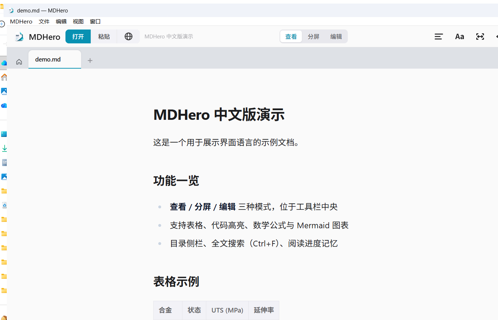

<div align="center">

# MDHero Chinese Edition (mdhero-zh)

A **Simplified-Chinese local build** of [MDHero](https://github.com/vaibhav-kakde-in/mdhero) —
a fast, beautiful native Markdown reader & lightweight editor

Built from upstream **v0.2.10** + official i18n PR [#141](https://github.com/vaibhav-kakde-in/mdhero/pull/141)

   

</div>



---

> 🇨🇳 中文版（主文档）：见 [README.md](README.md)

## ✨ What this is

MDHero is a Tauri-based native Markdown viewer/editor (~8 MB, free, open source), but its UI
is English-only today. This repo is my personal **Chinese build**: the latest official code plus
the Simplified-Chinese translation from the official i18n branch, compiled and packaged locally.

## 🔧 Differences from the official release

| | Official v0.2.10 | This build |
| --- | --- | --- |
| UI language | English only | **Simplified Chinese / English switchable** (Settings → General → Language); native menu bar follows the UI language; first-run language picker |
| Code baseline | `main` @ v0.2.10 | official `main` + PR #141 (i18n branch, 5 commits) |
| Code signing | unsigned (Windows) | unsigned (self-built) |
| In-app updater | points at official releases | **do not use** (see caveats) |
| AI features | official AI Lookup (opens browser) | unchanged; **no** third-party AI panel added |

Apart from i18n there are **zero functional changes** — rendering, editing, split view, Marp
presentations, live reload, printing etc. all match official v0.2.10.

## 📥 Install

Download from [Releases](../../releases) (pick one):

- `MDHero_0.2.10_x64_en-US.msi` — recommended
- `MDHero_0.2.10_x64-setup.exe` — NSIS installer

> ⚠️ **First launch**: the installers are not code-signed, so Windows SmartScreen may warn about
> an unknown publisher. Click **More info → Run anyway**. This is normal for unsigned open-source builds.

> ⚠️ **If the official English MDHero is installed**: uninstall it first (Settings → Apps) to avoid
> update-detection conflicts.

> ⚠️ **Do not use the in-app "Check for updates / Update now"**: the build embeds the official update
> feed, which would replace this Chinese build with the English official package. To get a newer
> version, grab a new Release here or rebuild from source.

On first launch a language dialog appears — choose **简体中文**. You can switch anytime in
Settings → General → Language (system-default detection supported).

## 🛠️ Build from source

Requirements (Windows):

- [Node.js](https://nodejs.org/) ≥ 20 (tested on v25) + [pnpm](https://pnpm.io/) ≥ 9
- [Rust](https://rustup.rs/) stable-msvc toolchain
- Visual Studio Build Tools (Desktop C++ workload) + Windows 11 SDK

```bash
pnpm install
pnpm check        # type check, 0 errors
pnpm test         # unit tests, 225 passing
pnpm tauri build --bundles msi,nsis   # artifacts in src-tauri/target/release/bundle/
```

> 💡 On Windows, run `git config core.autocrlf false` before checking out, then re-checkout.
> CRLF line endings otherwise break the `version-sync` and `quicklook-bundle` tests
> (repo scripts are written for LF; unrelated to localization).

## 📁 Repo layout

Upstream structure is preserved; changes are concentrated in:

```
src/lib/i18n/            # i18n module (from official PR #141)
  locales/zh-CN.json     #   Simplified Chinese (262 keys; the 2 absent ones are English plural forms N/A in Chinese)
  locales/en.json        #   English fallback
  locales/{de,es,fr}.json#   other official translations
src-tauri/src/menu.rs    # native menu follows the UI language
assets/screenshot-zh.png # screenshot used in this README
README.md                # primary (Chinese)
README.en.md             # this file
README.upstream.md       # original upstream README, untouched
```

## ⚖️ License & disclaimer

- Upstream MDHero and this build are under the **MIT License** (see [LICENSE](LICENSE)).
- This is a **personal, unofficial build**, not affiliated with or endorsed by MDHero.
- Installers are unsigned; building from source yourself is the recommended path
  (which is why the full source lives here).
- Original documentation: [README.upstream.md](README.upstream.md) · [mdhero.app](https://mdhero.app)

## 🙏 Credits

- [vaibhav-kakde-in/mdhero](https://github.com/vaibhav-kakde-in/mdhero) — the upstream author & maintainers
- [@hdo-projects](https://github.com/hdo-projects) et al. — authors of official i18n PR #141 (the zh-CN work builds on it)
- Once Chinese lands upstream, this repo will retire or turn into a pure build guide
